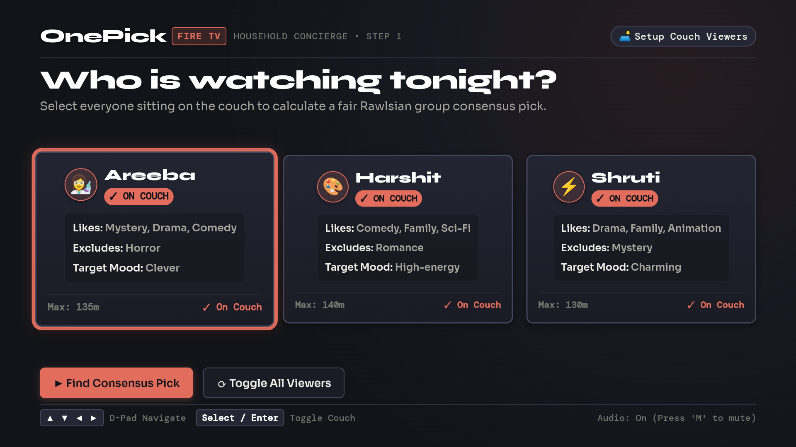
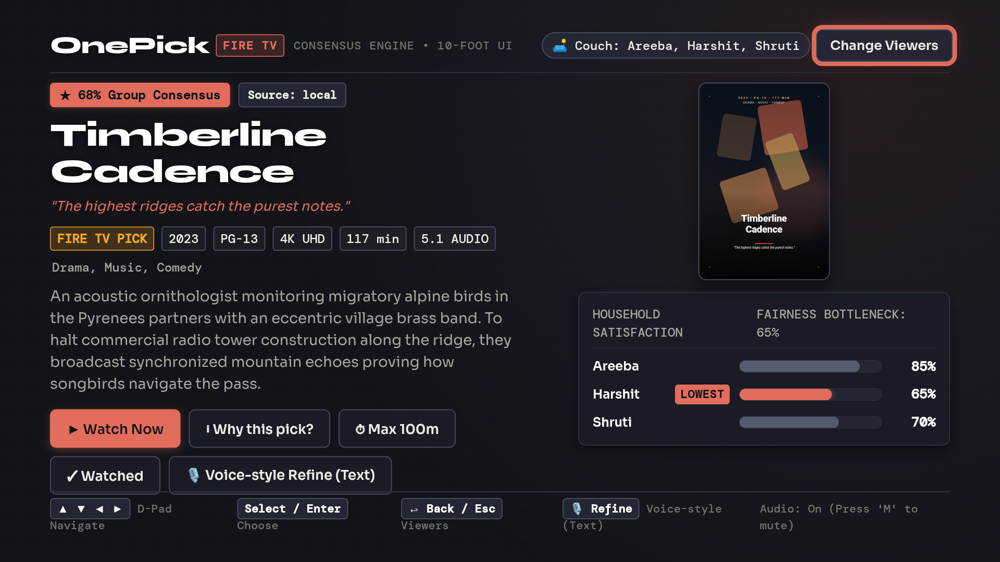
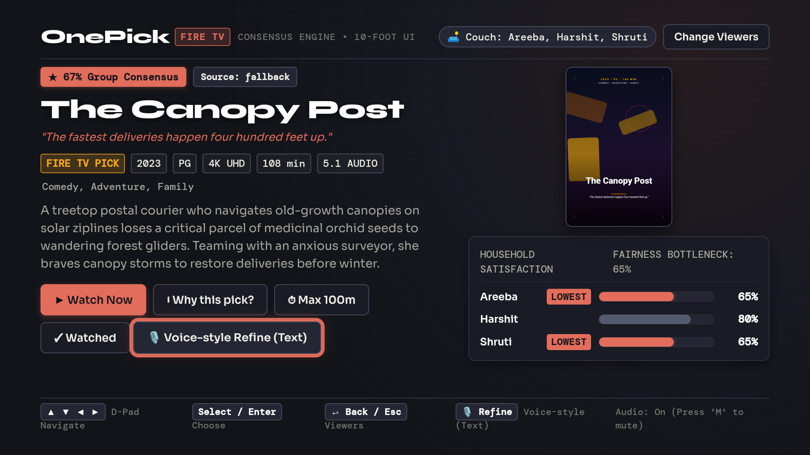
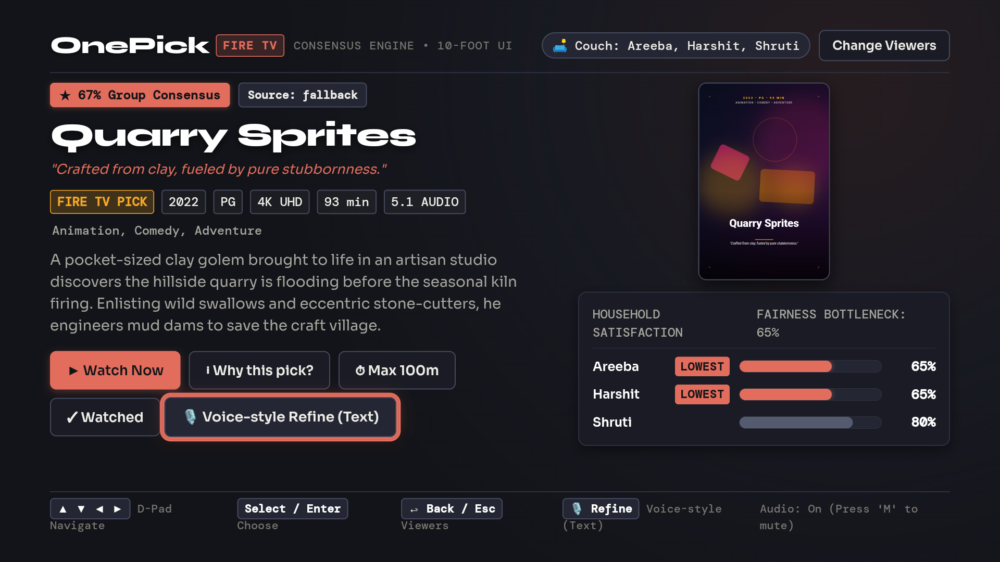
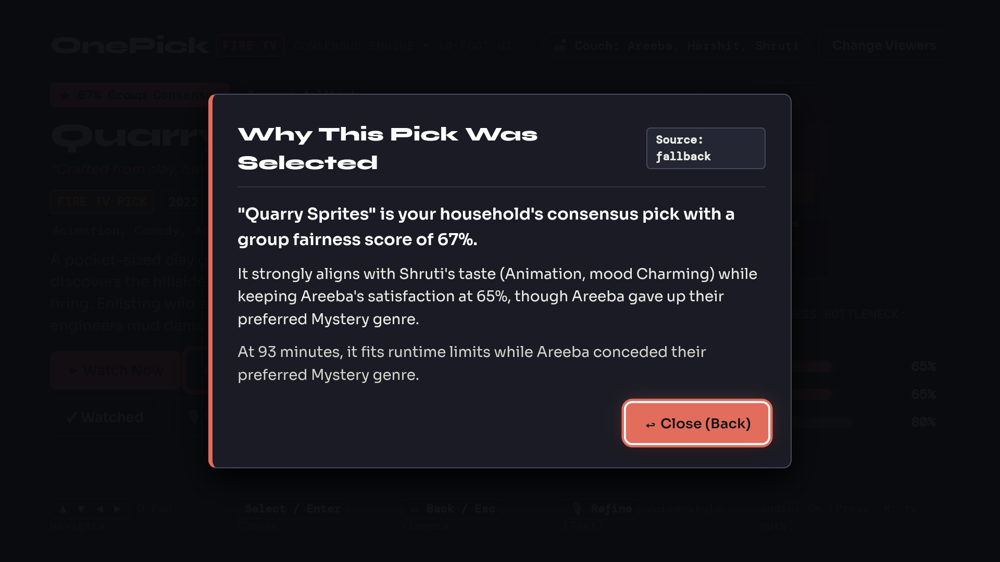
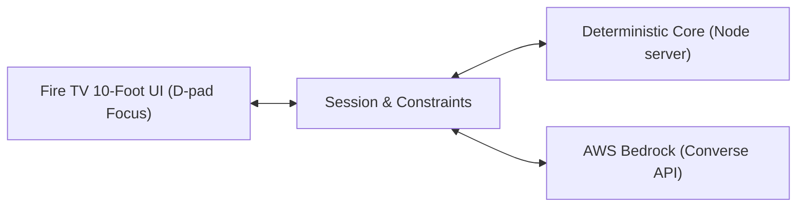

# OnePick 📺
> AI household viewing concierge on Fire TV for multi-viewer group consensus.

[](LICENSE)
[](https://www.typescriptlang.org/)
[](https://nodejs.org/)
[](#-quick-start)

---

## 💡 What It Does
When several people sit down in front of one TV, households often spend a long time debating what to watch. OnePick activates household profiles on the couch and calculates a single fair group pick using deterministic Rawlsian max-min fairness. Viewers can apply typed refinements, parsed by a built-in rule-based parser, or by Amazon Nova Lite via Bedrock when available, and view a plain-English explanation of why the pick balances everyone's preferences.

---

## 📺 Screenshots (Android TV emulator, 1080p)
*Captured on an Android TV emulator (API 34) at 1080p resolution, not a physical Fire TV device.*

| Screen | Caption |
| :--- | :--- |
|  | **Viewer Selection:** Couch setup with all three viewers selected (*Areeba*, *Harshit*, *Shruti*). |
|  | **Step 1 Consensus Pick:** *Timberline Cadence* (117 min, 68% group score). |
|  | **Step 2 Typed Refinement:** *The Canopy Post* (108 min, 67% group score) after typing watched filter. |
|  | **Step 3 Typed Refinement:** *Quarry Sprites* (93 min, 67% group score) after typing max 100 min constraint. |
|  | **Explanation Modal:** Transparent compromise breakdown for *Quarry Sprites* (93 min, 67% group score). |

---

## ⚖️ How the Fairness Rule Works
Rather than using a simple average where one unhappy viewer can be steamrolled by an enthusiastic majority, OnePick applies **Rawlsian max-min fairness**:

$$\text{groupScore} = \text{round}(0.6 \times \text{minViewerScore} + 0.4 \times \text{avgViewerScore})$$

The formula gives 60% of the weight to the lowest viewer score and 40% to the average, prioritizing lifting the satisfaction floor.

### Hard Filters
Before scoring, candidates must pass four strict filters:
1. **Excluded Genres:** Any title matching a viewer's personal dealbreaker is excluded.
2. **Runtime Limit:** Titles exceeding the session's active maximum duration are excluded.
3. **Already Watched:** Titles previously seen or marked as watched are excluded.
4. **Required Genre:** If a specific genre is demanded, non-matching titles are excluded.

---

## 🎬 3-Step Demo
| Step | What You Do | Pick | Runtime | Group Score | Scores (Areeba / Harshit / Shruti) |
| :---: | :--- | :--- | :---: | :---: | :---: |
| **1** | Select all three viewers on the couch | *Timberline Cadence* | 117 min | 68% | 85 / 65 / 70 |
| **2** | Type: *"We already watched Timberline Cadence together last week"* | *The Canopy Post* | 108 min | 67% | 65 / 80 / 65 |
| **3** | Type: *"Shruti has to wake up early tomorrow, keep it under 100 minutes"* | *Quarry Sprites* | 93 min | 67% | 65 / 65 / 80 |

Across all three steps the lowest viewer score holds at 65% while the least-happy viewer changes from step to step.

---

## 🏛️ Architecture



- **Fire TV Client (`app/`, `fireos/`):** 1080p spatial TV interface wrapped in an Android Leanback WebView with D-pad navigation.
- **Core Engine (`core/`):** Offline-capable TypeScript scoring and fairness engine that runs locally with no network calls and zero external I/O.
- **Bedrock Layer (`api/bedrock.ts`):** Natural-language constraint parsing and explanation generation via Converse API (`amazon.nova-lite-v1:0`) with deterministic local fallbacks.

---

## 🚀 Quick Start

### 1. Prerequisites
- Node.js `v22.x` (or match `.nvmrc`)
- npm `v10.x` or higher
- Android SDK (API 34) and Java 17 (for Fire OS build)

### 2. Local Web Server & Tests
```bash
# Clone the repository
git clone https://github.com/shrutimishrads/OnePick.git
cd OnePick

# Install dependencies and run test suite
npm install
npm test
npm run typecheck

# Start local Fire TV web app server on port 3000
npm run tv
```
Open `http://localhost:3000` in a browser or point the Fire OS WebView to it.

### 3. Build & Install Fire OS Leanback APK
```powershell
cd fireos
.\gradlew.bat assembleDebug
adb install -r app/build/outputs/apk/debug/app-debug.apk
```

---

## 📊 Status: What Is Verified and What Is Not

| Component / Feature | Status | Notes |
| :--- | :---: | :--- |
| **Android TV Emulator** | Verified | Tested on Android 14 (API 34) 1080p emulator with D-pad navigation and native input dialogs. |
| **Scoring & Test Suite** | Verified | 35 automated tests passing across core fairness, Bedrock fallback, and HTTP routes. |
| **Deterministic Fairness** | Verified | Offline-capable Rawlsian max-min math executed locally without external dependencies. |
| **Amazon Bedrock (Nova Lite)** | Integrated (Not Live-Verified) | Bedrock (Nova Lite via the Converse API) is integrated with a deterministic fallback, and a live call was not verified because of a Free-plan quota. |
| **Physical Fire TV Hardware** | Not Verified | Not tested on physical Fire TV stick/cube hardware or physical Alexa voice remote. |

---

## 🎬 3-Minute Demo
- **Demo Video:** [TODO: Upload 3-minute demo video and insert URL prior to final hackathon deadline]

---

## 📦 Repository Structure & Documentation

```text
onepick/
├── app/            # Fire TV 10-foot web UI (HTML/CSS/JS) and local Node server
├── fireos/         # Android Leanback WebView APK project (Gradle 8.7, API 34)
├── core/           # Deterministic TypeScript scoring, constraints, and tests
├── api/            # Bedrock Converse API handlers (parse + explain + fallbacks)
├── data/           # Curated catalogue (20 fictional titles) and viewer fixtures
├── docs/           # Architecture, setup guides, and friction logs
└── scripts/        # Screenshot capture and automated demo walkthrough scripts
```

- [Architecture Guide](docs/architecture.md)
- [Fire TV Setup Guide](docs/fire-tv-setup.md)
- [Devpost Submission Narrative](docs/devpost-submission.md)
- [Product & Tooling Friction Log](docs/product-feedback.md)

---

## 👥 Team & License
- **Built by:** Areeba, Harshit, and Shruti for the *Build, Ship, Shape: Amazon Developer Hackathon*.
- **License:** Licensed under the [MIT License](LICENSE).
