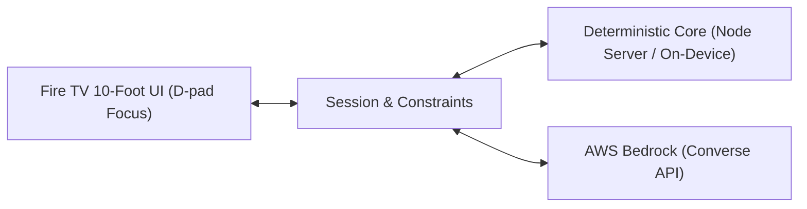

# OnePick 📺
> **AI household viewing concierge on Fire TV**  
> *Built for the Amazon Developer Hackathon (Fire TV track & AWS Builder mini challenge)*

---

## 💡 The Problem
Every evening, households waste 30 to 45 minutes stuck in endless browsing carousels debating what to watch. Traditional recommendation engines personalize strictly for individual profiles, leading to compromises where someone is always unhappy.

## 🎯 The Solution
**OnePick** is a 10-foot Fire TV application that resolves viewing conflicts in under 60 seconds:
1. **Multi-Viewer Consensus:** Activates household members on the couch, combining individual preferences and hard dealbreakers.
2. **Deterministic Max-Min Fairness Engine:** Guarantees no single person gets steamrolled by maximizing the satisfaction of the least-satisfied viewer.
3. **Conversational Constraint Patching:** Powered by Amazon Bedrock Converse API to seamlessly update constraints via voice-style refine (text input) or quick shortcuts ("we already saw that", "something under 90 minutes").
4. **Transparent Consensus AI:** Explains *why* a title was picked in plain English, highlighting compromise trade-offs.

---

## 📺 Screenshots (Android TV emulator, 1080p)

These screenshots were captured on an Android TV emulator (API 34), not a physical Fire TV device.

- **Viewer Selection:** Couch setup with all three viewers selected (*Areeba*, *Harshit*, *Shruti*).  
  
- **Step 1 Consensus Pick:** *Timberline Cadence* (117 min, 68% group score).  
  
- **Step 2 Refinement (Typed Refinement):** *The Canopy Post* (108 min, 67% group score).  
  
- **Step 3 Runtime Constraint (Typed Refinement):** *Quarry Sprites* (93 min, 67% group score).  
  
- **Consensus Explanation Modal:** Transparent compromise breakdown for *Quarry Sprites* (93 min, 67% group score).  
  

---

## 🏛️ Architecture



- **Fire TV Client (`app/`):** A 10-foot television web UI served by a local Node server (`app/server.ts`) and wrapped in a native Fire OS Android Leanback WebView (`fireos/`). Designed specifically for remote D-pad spatial navigation, 1080p television scaling, and accessible WCAG AA contrast.
- **Core Engine (`core/`):** Zero-latency, deterministic TypeScript fairness engine executed in the Node server. Offline-capable and 100% testable with no external network I/O.
- **Bedrock Layer (`api/bedrock.ts`):** Handles intent interpretation and consensus explanation synthesis using Amazon Bedrock Converse API (`amazon.nova-lite-v1:0`). Bedrock never hallucinates titles—all ranking originates strictly from `core`.

---

## 📁 Repository Structure

```text
onepick/
├── app/            # Fire TV 10-foot web UI served by Node server (wrapped in fireos/ WebView)
│   ├── index.html  # 1080p spatial TV interface (D-pad navigation, WCAG AA contrast)
│   ├── server.ts   # Node HTTP server executing core engine & Bedrock API routes
│   └── assets/     # High-contrast vector artwork and fallback hero graphics
├── fireos/         # Fire OS Android Leanback WebView wrapper
├── core/           # Pure TypeScript: scoring, constraints, types (no I/O, runs in Node)
│   ├── types.ts
│   ├── scoring.ts
│   └── scoring.test.ts
├── api/            # Bedrock Converse API integration handlers (parse + explain)
├── data/           # Curated catalogue (20 fictional titles) + viewer fixtures
├── docs/           # Architecture diagrams, demo script, screenshots
│   ├── architecture.md
│   ├── demo-script.md
│   └── screenshots/
├── scripts/        # Screenshot capture and automated demo walkthrough scripts
├── .nvmrc          # Node version pin
├── .env.example    # Environment variable placeholders
├── LICENSE         # MIT Open-Source License
└── package.json    # Monorepo scripts
```

---

## 🚀 Quick Start

### Prerequisites
- Node.js `v22.x` (or match `.nvmrc`)
- npm `v10.x` or higher
- Git

### Installation & Testing
```bash
# Clone the repository
git clone https://github.com/shrutimishrads/OnePick.git
cd OnePick

# Install dependencies
npm install

# Run scoring engine & Bedrock unit tests
npm test

# Run TypeScript type check
npm run typecheck

# Start local Fire TV web app server (serves app/ on port 3000)
npm run tv
```

---

## 🎬 3-Minute Demo
- **Demo Video:** [TODO: Upload 3-minute demo video and insert URL prior to final hackathon deadline]
- **Demo Script:** See [docs/demo-script.md](docs/demo-script.md) for the 3-minute video recording walkthrough.

---

## 📄 License
This project is licensed under the MIT License - see the [LICENSE](LICENSE) file for details.
