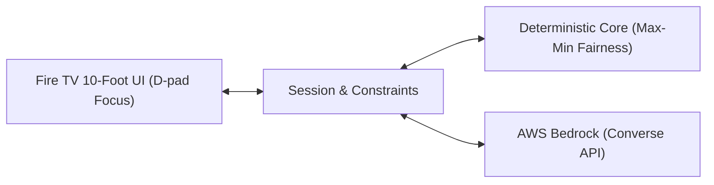

# OnePick 📺
> **AI household viewing concierge on Fire TV**  
> *Built for the Amazon Developer Hackathon (Devpost)*

---

## 💡 The Problem
Every evening, households waste 30 to 45 minutes stuck in endless browsing carousels debating what to watch. Traditional recommendation engines personalize strictly for individual profiles, leading to compromises where someone is always unhappy.

## 🎯 The Solution
**OnePick** is a 10-foot Fire TV application that resolves viewing conflicts in under 60 seconds:
1. **Multi-Viewer Consensus:** Activates household members on the couch, combining individual preferences and hard dealbreakers.
2. **Deterministic Max-Min Fairness Engine:** Guarantees no single person gets steamrolled by maximizing the satisfaction of the least-satisfied viewer.
3. **Conversational Constraint Patching:** Powered by Amazon Bedrock Converse API to seamlessly update constraints via voice or quick text ("we already saw that", "something under 90 minutes").
4. **Transparent Consensus AI:** Explains *why* a title was picked in plain English, highlighting compromise trade-offs.

---

## 🏛️ Architecture



- **Core Engine (TypeScript):** Zero-latency, runs directly on device or in cloud Lambda. Deterministic, fully testable, and offline-capable.
- **Bedrock Layer:** Handles intent interpretation and consensus explanation synthesis. Bedrock never hallucinates titles—all ranking originates from `core`.

---

## 📁 Repository Structure

```text
onepick/
├── app/            # Fire TV 10-foot web app and Node server
├── fireos/         # Fire OS Android Leanback WebView wrapper
├── core/           # Pure TypeScript: scoring, constraints, types (no I/O)
│   ├── types.ts
│   ├── scoring.ts
│   └── scoring.test.ts
├── api/            # Bedrock Converse API Lambda handlers (parse + explain)
├── data/           # Curated catalogue (catalogue.json) + viewer fixtures
├── docs/           # Architecture diagrams, demo script, screenshots
│   ├── architecture.md
│   └── demo-script.md
├── .nvmrc          # Node version pin
├── .env.example    # Environment variable placeholders
├── LICENSE         # MIT Open-Source License
└── package.json    # Monorepo scripts
```

---

## 🚀 Quick Start

### Prerequisites
- Node.js `v22.x` (or match `.nvmrc`)
- npm `v10.x` or higher
- Git

### Installation & Testing
```bash
# Clone the repository
git clone https://github.com/shrutimishrads/OnePick.git
cd OnePick

# Install dependencies
npm install

# Run scoring engine unit tests
npm test
```

---

## 🎬 3-Minute Demo
See the complete demo video here :

---

## 📄 License
This project is licensed under the MIT License - see the [LICENSE](LICENSE) file for details.
