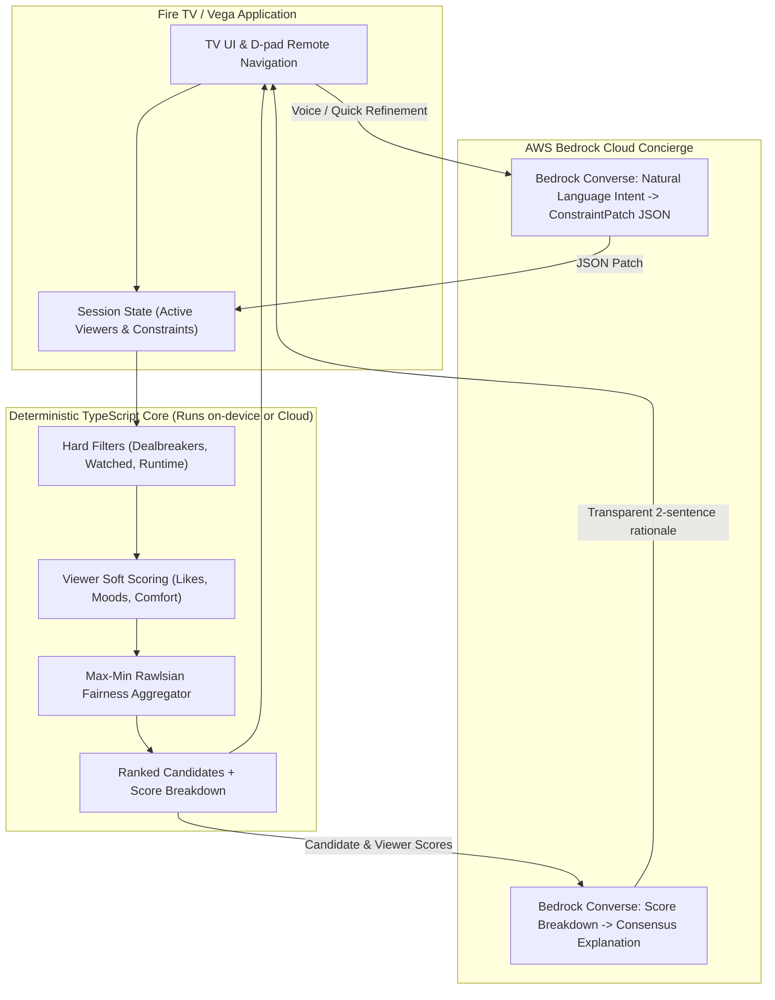

# OnePick Architecture

## Architectural Highlights
1. **Separation of Concerns:** Bedrock never invents movie titles or hallucinates rankings. All ranking is strictly deterministic, fast, and repeatable.
2. **Offline Fallback:** If internet connectivity drops or Bedrock is unreachable, the core scoring engine and rule-based explanations run entirely locally on the Fire TV device.
3. **Max-Min Group Fairness:** Rather than simple averaging (which favors the majority and leaves one person miserable), OnePick maximizes the lowest satisfaction score across all present viewers.
