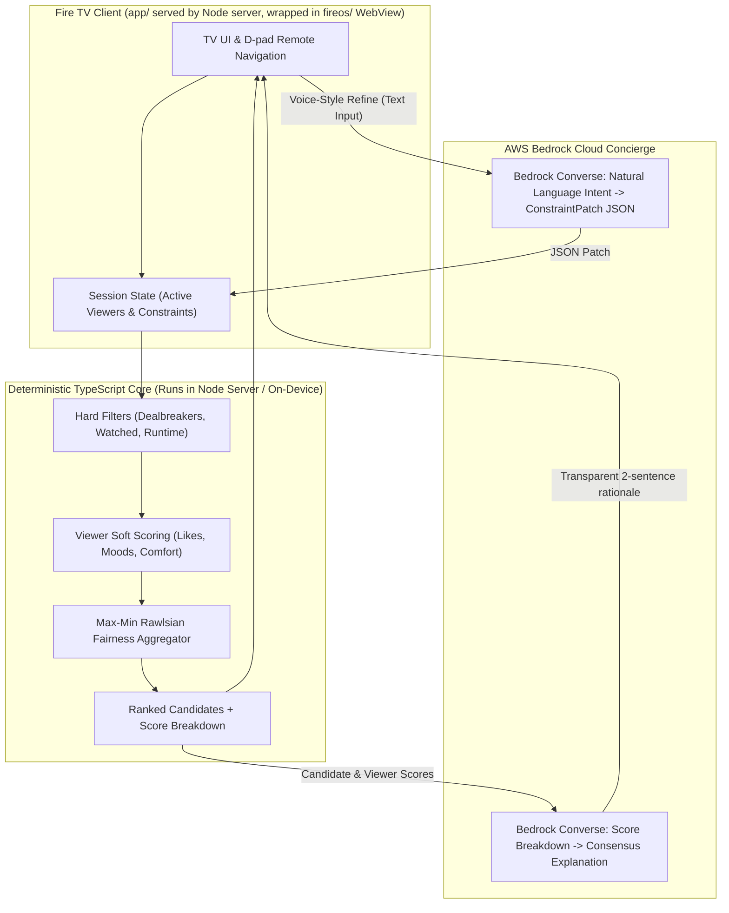

# OnePick Architecture

## Architectural Highlights
1. **Client / Server Model:** `app/` is a 10-foot web interface served by a local Node server (`app/server.ts`) and packaged inside a native Fire OS Android Leanback WebView (`fireos/`).
2. **Separation of Concerns:** Bedrock never invents movie titles or hallucinates rankings. All ranking is strictly deterministic, fast, and repeatable via pure TypeScript algorithms in `core/`.
3. **Offline Fallback:** If internet connectivity drops or Bedrock is unreachable, the core scoring engine and rule-based explanations run entirely locally in the Node server / on-device.
4. **Max-Min Group Fairness:** Rather than simple averaging (which favors the majority and leaves one person miserable), OnePick maximizes the lowest satisfaction score across all present viewers.
